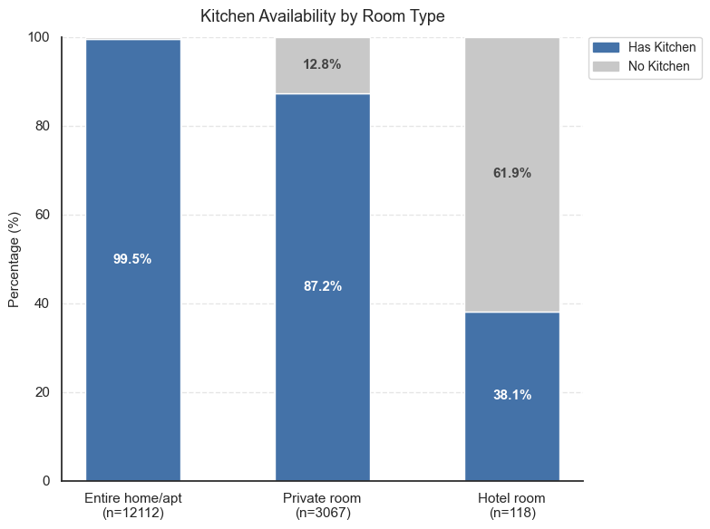
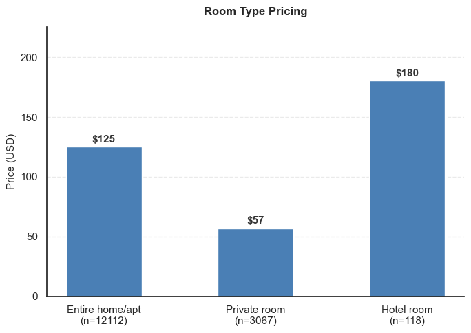
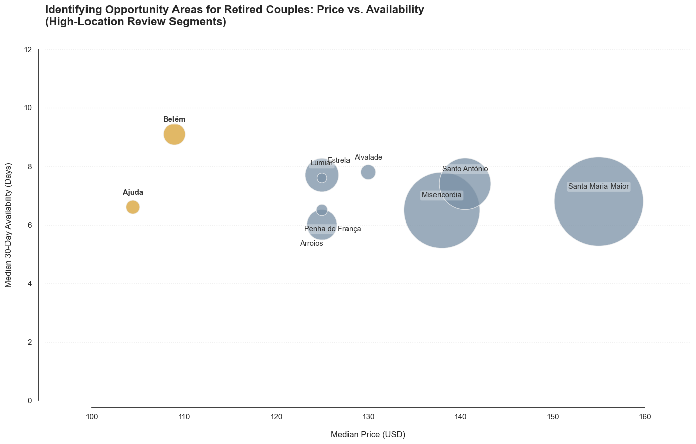
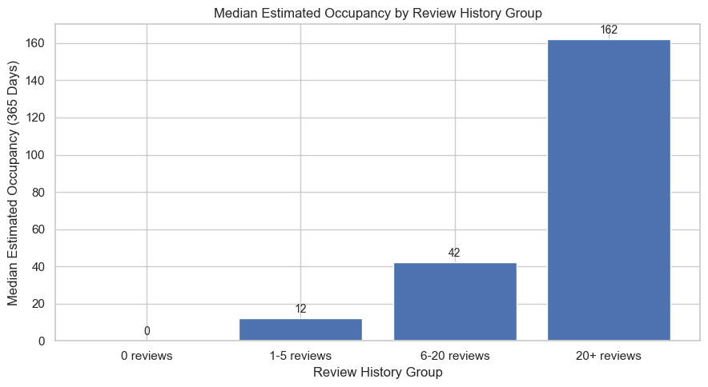

# Finding a Market Gap in Lisbon's Accommodation Market

**Is there an underserved accommodation segment in Lisbon, and how could a business capture it?**
Target segment: **middle-class retired couples (55+)**, who travel off-peak, stay longer and want to cook for themselves.

📄 [Full report](report/lisbon_market_gap_report.pdf) · 📊 [Slides](report/lisbon_market_gap_slides.pdf) · 💻 [Notebook](notebooks/lisbon_listing_analysis.ipynb)

## Approach
1. **Empathy map → measurable criteria.** Turned customer needs into listing-level variables:

   | Need | Proxy in the data |
   |---|---|
   | Privacy | room type |
   | Kitchen | keyword search in amenities |
   | Affordability | nightly price |
   | Good location | location review score |
   | Short-notice booking | 30-day availability vs. minimum nights |

2. **Cleaning.** Converted price text to numbers; filled missing price (14%) with the room-type median and missing bedrooms/beds/bathrooms with the median for the same room type and guest count.
3. **Staged filtering.** Lisbon municipality → fits 2 guests with ≥1 bedroom, bed and bathroom → compare room types → compare neighbourhoods → test review history.

## Key findings
**1. Entire homes are the right product, but cost ~2× a private room.** 99.5% have a kitchen vs. 38% of hotel rooms.

 

**2. Belém and Ajuda offer the best price-location balance.** Central districts (Santa Maria Maior, Misericórdia) have the most supply but the highest prices.

**3. There is a credibility gap, not just a supply gap.** Among suitable entire homes with a kitchen, median estimated occupancy is **0 nights for listings with no reviews**, versus 12 (1–5 reviews), 42 (6–20) and **162 (20+)**. Suitable homes sit empty because guests don't trust them yet.

## Recommendation
- **Branded, professionally managed entire-home model** with standardised cleanliness, safety and kitchen kit, so new listings are trusted before they have reviews.
- **Pilot in Belém and Ajuda**, where price and location appeal are best balanced.
- Grow by **making existing supply bookable and trusted**, not by adding new short-term rentals (which Lisbon is restricting).

## Data
[Inside Airbnb](https://insideairbnb.com/get-the-data/), Lisbon `listings.csv.gz`. Download it and save as `data/listings.csv` to run the notebook.

**Tools:** Python (pandas, NumPy, matplotlib, seaborn)
